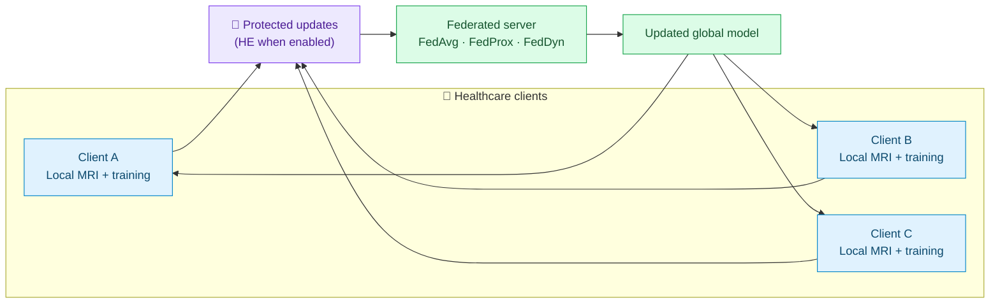
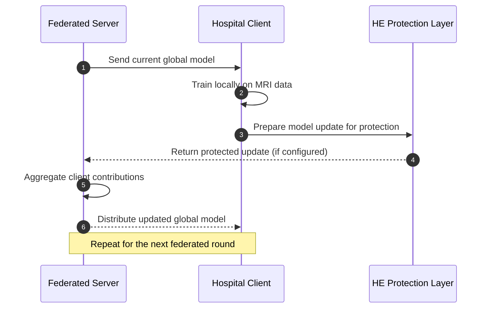
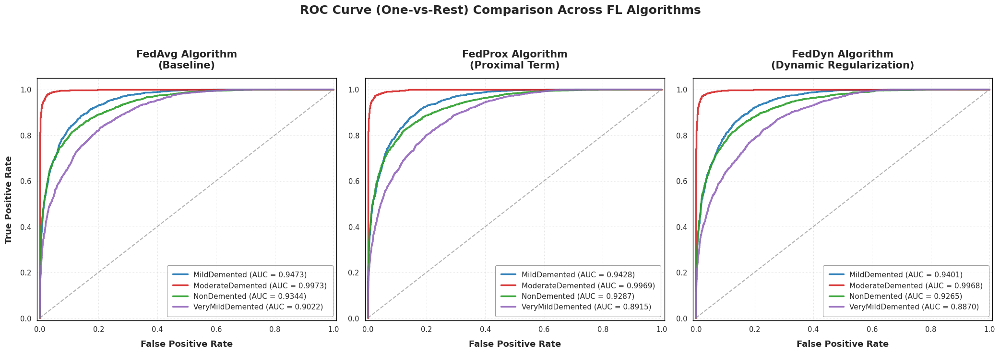
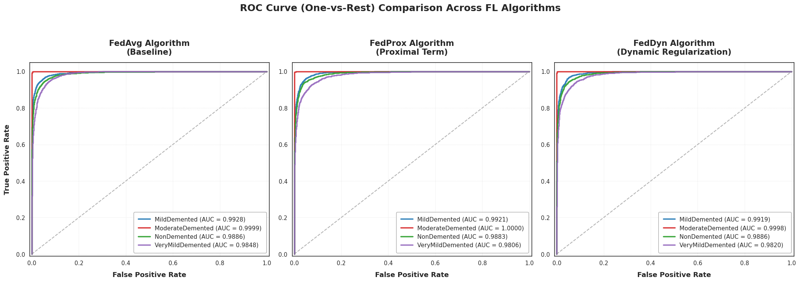
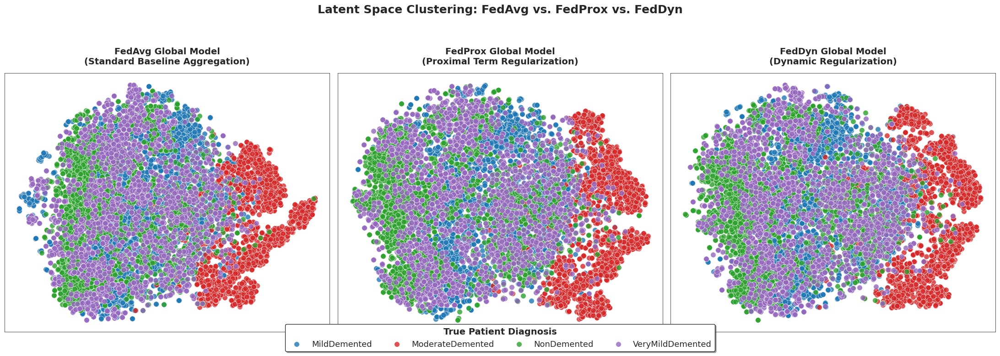
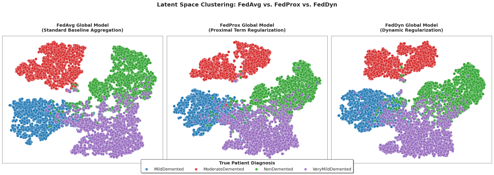

<!--
  Project: Privacy-Aware Federated Learning for Alzheimer's MRI Classification
  Author: Supriyo Sarkar
  Repository: https://github.com/Supriyo016/Alzheimer-s-Disease-Detection-for-Non-IID-Using-Federated-Learning-Under-HE
-->

<p align="center">
  
</p>

<div align="center">

<p align="center">
  
</p>

<p>
  <a href="https://github.com/Supriyo016/Alzheimer-s-Disease-Detection-for-Non-IID-Using-Federated-Learning-Under-HE">
    
  </a>
  <a href="https://www.python.org/">
    
  </a>
  <a href="https://jupyter.org/">
    
  </a>
  <a href="LICENSE">
    
  </a>
</p>

<p>
  
  
  
  
</p>

**A research-oriented implementation exploring collaborative MRI-based Alzheimer's disease classification across decentralised clients, with a focus on heterogeneous (Non-IID) data and privacy-preserving learning.**

[📘 Read the Thesis](Thesis/Supriyo_Sarkar_M.Tech_CSE_Dissertation_II.pdf) ·
[📂 Browse Notebooks](Project%20Files/) ·
[📊 Explore Results](Images/) ·
[🐛 Report an Issue](https://github.com/Supriyo016/Alzheimer-s-Disease-Detection-for-Non-IID-Using-Federated-Learning-Under-HE/issues)

</div>

---

## 📑 Table of Contents

- [🌍 Project Overview](#project-overview)
- [🎯 Research Objectives](#-research-objectives)
- [🧩 Research Workflow](#-research-workflow)
- [🛡️ Core Concepts](#️-core-concepts)
- [🧪 Models and Experiments](#-models-and-experiments)
- [📊 Final Comparative Results](#-final-comparative-results)
- [🗂️ Repository Structure](#️-repository-structure)
- [⚙️ Getting Started](#️-getting-started)
- [🧰 Technology & Tools](#-technology--tools)
- [🔬 Reproducibility Notes](#-reproducibility-notes)
- [⚠️ Limitations and Responsible Use](#️-limitations-and-responsible-use)
- [🚀 Future Scope](#-future-scope)
- [📚 Thesis and References](#-thesis-and-references)
- [🤝 Contributing](#-contributing)
- [📬 Contact](#-contact)
- [⭐ Support the Project](#-support-the-project)

---

## 🌍 Project Overview

Alzheimer's disease is a progressive neurological condition. MRI data can provide useful information for research into computer-assisted analysis, but medical data are often distributed across hospitals or institutions and cannot always be pooled in one central location.

This project studies a **federated learning (FL) approach** to multi-class Alzheimer's MRI classification. Instead of requiring every participating client to send its image data to a central server, each client trains locally and contributes model information to a shared global learning process.

The work places particular emphasis on:

- **Non-IID data:** client datasets may differ in class proportions and sample counts.
- **Federated optimisation:** comparison of FedAvg, FedProx and FedDyn approaches.
- **MRI classification:** experiments with a custom CNN, EfficientNetB0 and MobileNetV2.
- **Privacy-aware collaboration:** the research explores the use of homomorphic encryption (HE) in the federated setting.
- **Evaluation:** classification and representation-learning visualisations are included in the repository.

> **Research scope:** This repository is an experimental academic project. It is not a clinically validated diagnostic system and must not be used to diagnose, screen, or make treatment decisions for any person.

## 🎯 Research Objectives

1. Investigate collaborative MRI classification without centralising the clients' original image datasets.
2. Study the effect of heterogeneous and non-IID client data on federated model training.
3. Compare federated optimisation strategies, including **FedAvg**, **FedProx** and **FedDyn**.
4. Evaluate multiple CNN-based feature extractors and classifiers.
5. Explore homomorphic encryption as an additional protection layer for information exchanged during federated training.
6. Analyse model behaviour using class-wise metrics, confusion matrices, ROC curves and feature-space visualisations.

## 🧩 Research Workflow

The high-level research pipeline is illustrated below. It is a conceptual overview; the exact execution order and encryption placement should be checked against the corresponding experiment notebook and thesis.

<div align="center">
  
  <p><em>Experimental design included in the repository.</em></p>
</div>


### 🏥 Federated system architecture

Clients train locally and send model updates for server-side aggregation. Homomorphic encryption is shown as an optional protection layer; its exact use depends on the experiment.



### 🔁 Protected communication sequence



### 🔄 Federated learning cycle

1. **Local data:** each participating client keeps its MRI images locally.
2. **Initialisation:** clients receive the current global model parameters.
3. **Local optimisation:** each client trains its model using its own available data.
4. **Protected exchange:** the proposed privacy-aware workflow investigates homomorphic encryption for communicated model information.
5. **Server aggregation:** the selected federated strategy combines client contributions.
6. **Global update:** the updated model is distributed for the next communication round.
7. **Evaluation:** global model behaviour is assessed using held-out evaluation data and relevant classification metrics.

### 🧠 Why Non-IID data matters

In a realistic multi-institution setting, clients may have different patient populations, acquisition protocols, class frequencies and dataset sizes. This creates a statistical heterogeneity problem: a model trained on one client's data may not generalise equally well to another client's distribution.

The repository includes a client data distribution visualisation to make this challenge easier to inspect.

<div align="center">
  
  <p><em>Illustration of data distribution across clients.</em></p>
</div>

## 🛡️ Core Concepts

| Component | Role in the research |
|---|---|
| Federated Learning | Enables clients to participate in collaborative model training while retaining their local datasets. |
| Non-IID data | Represents differences in data distributions across clients. |
| FedAvg | Aggregates client model updates using a data-size-weighted averaging approach. |
| FedProx | Adds a proximal term to local optimisation to help address statistical heterogeneity. |
| FedDyn | Uses a dynamic regularisation strategy to reduce client drift. |
| Homomorphic Encryption | Allows supported computations on encrypted values; the project explores it for protecting exchanged information. |
| CNN architectures | Learn image representations for the four-class MRI classification task. |

### 🔐 Privacy is not the same as complete security

Federated learning does not automatically guarantee privacy: model updates can still reveal information. Homomorphic encryption can protect supported computations on encrypted values, but it does not by itself solve every privacy, integrity, access-control or deployment risk. Security depends on the complete protocol, key management, implementation and threat model.

## 🧪 Models and Experiments

The repository contains three model-specific Jupyter notebooks:

| Model | Notebook |
|---|---|
| Custom CNN | [Custom CNN Model Architecture.ipynb](Project%20Files/Custom%20CNN%20Model%20Architecture.ipynb) |
| EfficientNetB0 | [EfficientNetB0 Architecture.ipynb](Project%20Files/EfficientNetB0%20Architecture.ipynb) |
| MobileNetV2 | [MobileNetV2 Model Architecture.ipynb](Project%20Files/MobileNetV2%20Model%20Architecture.ipynb) |

The saved result figures cover comparisons between **FedAvg, FedProx and FedDyn**, including model-wise performance and feature-space analysis.

### 🏷️ Classification labels

The four categories represented in this research are:

| Label | Description |
|---|---|
| MildDemented | MRI images labelled as mild dementia |
| ModerateDemented | MRI images labelled as moderate dementia |
| NonDemented | MRI images labelled as non-demented |
| VeryMildDemented | MRI images labelled as very mild dementia |

These are dataset labels, not clinical conclusions. The class names and label encoding should be verified against the data preparation cells before reusing a notebook.

## 📊 Final Comparative Results

The following figures show the **final comparison of FedAvg, FedProx and FedDyn** across the three model architectures. Only comparative results are displayed here.

### ⚖️ F1-score comparison

<div align="center">
  
  
  
</div>

### 🎯 ROC curve comparison

<div align="center">
  
  
  
</div>

### 🧬 t-SNE feature-space comparison

<div align="center">
  
  
  
</div>

> **Note:** These figures are comparative experiment outputs. Refer to the thesis and notebook results for the evaluation protocol and exact metric values. t-SNE is an exploratory feature-space visualisation, not a quantitative performance metric.

---

## 🗂️ Repository Structure

```text
Alzheimer-s-Disease-Detection-for-Non-IID-Using-Federated-Learning-Under-HE/
│
├── Images/
│   ├── Experimental Design.png
│   ├── Client Data Distribution Bar Chart.png
│   ├── MRI sample visualisations
│   ├── Accuracy, loss and AUC plots
│   ├── Confusion matrices and ROC curves
│   ├── FedAvg / FedProx / FedDyn comparisons
│   └── t-SNE feature-space visualisations
│
├── Project Files/
│   ├── Custom CNN Model Architecture.ipynb
│   ├── EfficientNetB0 Architecture.ipynb
│   └── MobileNetV2 Model Architecture.ipynb
│
├── Thesis/
│   ├── Supriyo_Sarkar_M.Tech_CSE_Dissertation_II.pdf
│   └── main.pdf
│
├── LICENSE
└── README.md
```

## ⚙️ Getting Started

### ✅ Prerequisites

- Python 3.x
- Jupyter Notebook or JupyterLab
- A compatible machine/runtime for deep-learning experiments
- Access to the MRI dataset used by the notebooks
- The Python packages imported by the selected notebook

> Notebook-specific package versions and dataset paths should be taken from the notebook cells. They are not inferred here because the repository currently does not include a standalone dependency lockfile or a verified universal environment specification.

### 1. Clone the repository

```bash
git clone https://github.com/Supriyo016/Alzheimer-s-Disease-Detection-for-Non-IID-Using-Federated-Learning-Under-HE.git
cd Alzheimer-s-Disease-Detection-for-Non-IID-Using-Federated-Learning-Under-HE
```

### 2. Create and activate a virtual environment

**Windows (PowerShell):**

```powershell
python -m venv .venv
.venv\Scripts\Activate.ps1
```

**Linux / macOS:**

```bash
python3 -m venv .venv
source .venv/bin/activate
```

### 3. Install notebook requirements

Install the packages imported by the notebook you intend to run. For example, if the notebook imports TensorFlow and the standard scientific Python stack:

```bash
python -m pip install --upgrade pip
python -m pip install jupyter ipykernel numpy pandas matplotlib scikit-learn tensorflow
```

Install any additional dependencies used by the selected experiment (for example, the federated learning or homomorphic encryption libraries) using versions compatible with that notebook. Do not assume this illustrative command captures every dependency.

### 4. Launch Jupyter

```bash
jupyter notebook
```

Open one of the notebooks in `Project Files/`, then follow its cells in order.

### 5. Configure your dataset

Download or obtain the dataset from its authorised source and update the dataset paths in the notebook. Make sure that:

- the directory structure matches the loader implementation;
- class folders and labels are mapped consistently;
- training, validation and test data are separated correctly;
- the final test data is not used for training or tuning;
- no patient-level leakage occurs when patient identifiers are available.

**Dataset note:** The repository's tracked file list does not include the MRI image dataset. You must obtain it separately and comply with its licence and usage conditions.

## 🧰 Technology & Tools

The notebooks and research topic are centred on the following ecosystem. Confirm the exact library and version requirements in the notebook before setting up a reproducible environment.

<p align="center">
  
</p>

| Area | Tools / methods |
|---|---|
| Language | Python |
| Model experimentation | Jupyter Notebook |
| Deep learning | CNN architectures, EfficientNetB0, MobileNetV2 |
| Image analysis | MRI image preprocessing and visualisation |
| Federated optimisation | FedAvg, FedProx, FedDyn |
| Privacy research | Homomorphic encryption (HE) |
| Evaluation | Accuracy, precision, recall, F1-score, AUC, ROC and confusion matrices |
| Visual analysis | Matplotlib and t-SNE |

## 🔬 Reproducibility Notes

For reliable comparisons and future reuse, document the following for every experiment:

- dataset source, version, licence and class counts;
- image preprocessing, resizing and normalisation;
- patient-level or image-level split strategy;
- client partition method and Non-IID severity;
- client count, participation rate and local dataset sizes;
- model architecture, optimiser and training hyperparameters;
- federated rounds and local epochs;
- encryption scheme, parameters, key handling and encrypted payload details;
- random seeds and software/hardware environment;
- metrics computed on an untouched test set.

When comparing FedAvg, FedProx and FedDyn, use the same data partitions, model initialisation policy, evaluation protocol and computational budget wherever the method allows. Report variability across repeated seeds or folds rather than relying on one run.

## ⚠️ Limitations and Responsible Use

- **Research prototype:** the repository is for academic experimentation, not a medical product.
- **No clinical validation claim:** benchmark results on a public MRI dataset do not establish diagnostic validity in a hospital setting.
- **Dataset constraints:** results depend on dataset quality, labelling, sampling and possible class imbalance.
- **Privacy assumptions:** federated learning and homomorphic encryption do not automatically ensure end-to-end privacy or security.
- **Compute requirements:** deep-learning and encrypted computation can require substantial memory and processing time.
- **Reproducibility:** reproduce results with the exact data, code, configurations and software environment before drawing conclusions.

Do not upload identifiable patient data, private keys, credentials or sensitive clinical records to this repository.

## 🚀 Future Scope

Potential next steps for this line of research include:

- evaluating on multi-centre datasets with patient-level separation;
- testing stronger and more varied Non-IID partition settings;
- quantifying encryption overhead, communication cost and runtime;
- adding robust privacy and security analysis under a clearly stated threat model;
- evaluating calibration, external generalisation and subgroup performance;
- exploring communication-efficient aggregation and federated knowledge distillation;
- validating the complete workflow with clinical and institutional governance.

## 📚 Thesis and References

The detailed academic report is available here:

- 📕 [M.Tech Dissertation — Supriyo Sarkar](Thesis/Supriyo_Sarkar_M.Tech_CSE_Dissertation_II.pdf)
- 📄 [Thesis PDF (alternate copy)](Thesis/main.pdf)

For foundational reading, see the original publications and documentation for federated learning, FedAvg, FedProx, FedDyn, the chosen neural network architectures and the homomorphic encryption library used in the relevant notebook. Cite the exact versions and papers in any work that builds on this implementation.

## 🤝 Contributing

Suggestions, bug reports and research discussions are welcome.

1. Fork the repository.
2. Create a feature branch: `git checkout -b feature/your-change`.
3. Commit your changes with a clear message.
4. Push the branch and open a Pull Request.
5. Include enough detail to reproduce any new experiment or result.

For significant changes to the experimental protocol, please document the dataset split, client partition, model configuration and evaluation procedure.

## 📬 Contact

**Supriyo Sarkar**  
M.Tech, Computer Science and Engineering  
Kalyani Government Engineering College, India

<p>
  <a href="https://github.com/Supriyo016">
    
  </a>
  <a href="https://github.com/Supriyo016/Alzheimer-s-Disease-Detection-for-Non-IID-Using-Federated-Learning-Under-HE/issues">
    
  </a>
</p>

## ⭐ Support the Project

If this repository helps your learning or research, consider giving it a ⭐ on GitHub. Feel free to fork it, explore the notebooks and share constructive feedback.

---

<div align="center">

  

  <h3>🧠 Different Data. Shared Learning. A Smarter Future.</h3>

  <p><em>Exploring privacy-aware AI where collaboration grows without centralising raw data.</em></p>

  <p>⭐ <strong>Star</strong> the project · 🍴 <strong>Fork</strong> to experiment · 🤝 <strong>Contribute</strong> to advance the research</p>

  <sub>Built with curiosity, code and a commitment to responsible AI. 🔬🔐</sub>

  <sub>Last documentation refresh: November 2026</sub>

</div>

<p align="center">
  
</p>
